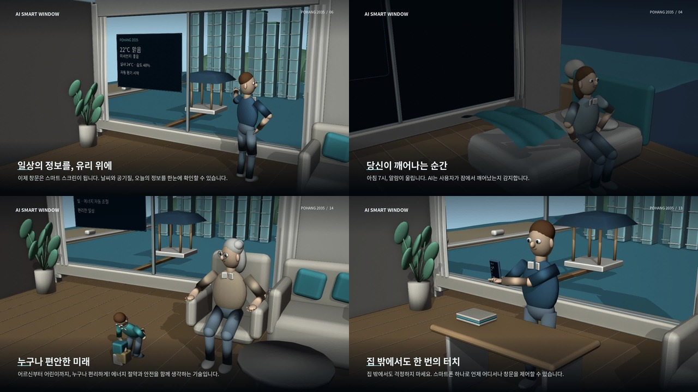

# AI 스마트 윈도우 – 포항의 내일을 여는 창

2035년 포항을 배경으로 AI 스마트 윈도우를 설명하는 3D 캐릭터 애니메이션입니다. 총 15장면, 2분 30초입니다.

[전체 영상 다운로드](https://github.com/wwplato/ai-video-project/raw/refs/heads/main/output/AI_Smart_Window_Pohang.mp4) · [30초 동작 미리보기](https://github.com/wwplato/ai-video-project/raw/refs/heads/main/output/motion_preview.mp4) · [음성 미리듣기](https://github.com/wwplato/ai-video-project/raw/refs/heads/main/output/audio_preview.mp3)

인물의 관절과 자세가 프레임마다 바뀌는 3D 애니메이션으로 제작했습니다. 학생이 걸어가 창을 터치하고, 사용자가 침대에서 상체를 일으켜 일어나며, 아이가 블록을 집어 옮겨 쌓습니다. 휴대폰을 누르는 손가락, 책장을 넘기는 손, 우산을 집는 동작도 포함했습니다. 바다의 파도, 차량, 식물, 커튼과 창문도 움직입니다.

미리보기에는 학생의 창문 터치, 기상, 가족의 블록 놀이를 10초씩 담았습니다.

기존에 확정한 한국어 내레이션·창문 안내와 잔잔한 피아노 음악의 AAC 오디오 스트림을 그대로 유지했습니다. 오디오 패킷 체크섬의 일치를 확인했습니다.

| 항목 | 검증 결과 |
| --- | --- |
| 길이 | 150초 (2분 30초), 15장면 |
| 영상 | H.264, 1920×1080, 24fps, 3,600프레임 |
| 인물 움직임 | 인물이 등장하는 13장면에서 관절 위치 또는 고개 회전 변화 확인 |
| 음성·음악 | 기존 AAC 스테레오, 44,100Hz 스트림 유지 |
| 파일 크기 | 48,810,474바이트 (약 46.55MiB) |
| 무결성 | 전체 영상 및 동작 미리보기 디코딩 성공 |

영상은 `output/AI_Smart_Window_Pohang.mp4`에 있습니다. 저장소를 내려받아 `output/영상보기.html`을 열어도 재생할 수 있습니다.

검증 기록: [파일·음성 검증](output/verification.json), [3D 관절 움직임 검증](output/motion_verification.json).
